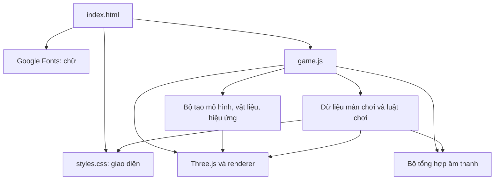

# Saltline — tài nguyên và nhiệm vụ của từng phần

[MEOW] Phân tích ngày 10/11/2026, dựa trên file đã thu hồi, mã định dạng và capture kiểm chứng đã lưu. Không thay đổi game hoặc tạo lại tài nguyên trong lượt phân tích này.

Điểm chính: **game tạo phần lớn mô hình, texture và âm thanh bằng mã trong `game.js`**. Gói thu hồi không có thư mục model/texture/audio riêng với các file GLB, FBX, MP3 hay WAV. Những PNG/JPG trong `evidence` là ảnh kiểm chứng, không phải ảnh đầu vào của cảnh game.

## 1. Ba file trực tiếp chạy game

| File | Kích thước | Chức năng/nhiệm vụ |
| --- | ---: | --- |
| [index.html](/Users/meow/rea/saltline-reverse/index.html:1) | 878 byte | Điểm mở game. Tạo canvas 3D, vùng giao diện và màn tải; nạp CSS, font và JavaScript. Đây là file đã tách khỏi lớp nhúng Claude. |
| [styles.css](/Users/meow/rea/saltline-reverse/styles.css:1) | 30.777 byte | Quy định màu, font, bố cục HUD/menu, thanh máu/đạn, dấu ngắm, phụ đề radio, nút cảm ứng và thích nghi kích thước màn hình. Giữ nguyên CSS thu hồi. |
| [game.js](/Users/meow/rea/saltline-reverse/game.js:1) | 1.391.985 byte | Chứa Three.js r180, các bộ tạo tài nguyên, shader, dữ liệu màn chơi và toàn bộ logic chạy game. Giữ nguyên bundle thu hồi. |

Tổng ba file: **1.423.640 byte**, khoảng **1,42 MB** hoặc **1,36 MiB**. Kích thước này không bao gồm font tải ngoài hay bộ nhớ GPU/audio sau khi tài nguyên đã được tạo. Game không cần đọc `evidence`, `tests` hoặc các báo cáo để chơi bình thường.

Luồng sử dụng:

Thứ tự khởi tạo được ghi trực tiếp tại [hàm boot](/Users/meow/rea/saltline-reverse/evidence/game.pretty.js:72636): renderer → vật liệu → vật lý/đạo cụ/input → màn chơi/phông cảnh/mặt đất → hiệu ứng/âm thanh → người chơi/chiến đấu/súng/kẻ địch → HUD/nhiệm vụ.

## 2. Mô hình 3D và đạo cụ

Registry `Gi` định nghĩa **36 loại đạo cụ**, gồm kích thước, vật liệu mặc định và loại bề mặt. Bộ `Yg` chọn hàm dựng tương ứng, gắn thông tin va chạm và trả về một nhóm vật thể Three.js. Đây là **36 loại có thể tạo**, không phải 36 vật thể duy nhất trong màn chơi. [Danh mục và bộ dựng](/Users/meow/rea/saltline-reverse/evidence/game.pretty.js:40627).

| Nhóm | Các loại trong registry | Nhiệm vụ |
| --- | --- | --- |
| Container | `container20`, `container40`, `container40hc`, `reefer_unit` | Tạo bãi hàng, khối kiến trúc/lối đi và thiết bị lạnh gắn với container. |
| Cổng, rào, phân luồng | `jersey_barrier`, `fence_panel`, `guard_booth`, `gate_arm`, `bollard_post`, `traffic_cone`, `sign_post` | Chia không gian, hình thành vật cản và biển chỉ dẫn trong cảng. |
| Bến tàu, ánh sáng | `bollard_mooring`, `light_mast`, `floodlight_stand` | Chi tiết neo tàu và cấu trúc chiếu sáng. |
| Kết cấu nhà kho | `shelf_rack`, `stairs_metal`, `catwalk` | Kệ hàng, cầu thang, sàn đi; góp phần tổ chức không gian và độ cao. |
| Hàng hóa | `barrel`, `pallet`, `pallet_stack`, `crate_wood`, `crate_stack`, `ibc_tote`, `cardboard_boxes`, `tarp_cargo`, `sandbags` | Làm đầy bãi/kho bằng hàng hóa và khối che chắn. |
| Thiết bị và vật dụng | `forklift`, `cable_reel`, `tire_stack`, `dumpster`, `generator`, `jerry_can`, `gas_cylinders`, `toolbox_cart`, `pipe_stack` | Dựng bối cảnh cảng đang vận hành, thêm hình khối và vật cản. |
| Mục tiêu nhiệm vụ | `relay_node` | Thiết bị tương tác; ba instance được đặt làm relay A/B/C và đổi trạng thái khi cắt. |

Chức năng trang trí của xe nâng, máy phát, bình nhiên liệu không tự chứng minh chúng có cơ chế lái xe, cấp điện hoặc phát nổ. Những cơ chế đó không được xác nhận trong phân tích này. Tương tự, cấu hình hình học/va chạm không có nghĩa mọi đạo cụ đều phá hủy được.

Ngoài danh mục đạo cụ còn có các nhóm riêng:

| Tài nguyên | Nhiệm vụ | Mã liên quan |
| --- | --- | --- |
| Súng PAC-9 và phần tay hiển thị | Hình ảnh người chơi nhìn thấy; bộ phận súng và tay chuyển động khi ngắm, bắn, nạp đạn, di chuyển | [Bộ dựng súng](/Users/meow/rea/saltline-reverse/evidence/game.pretty.js:64428), [runtime vũ khí](/Users/meow/rea/saltline-reverse/evidence/game.pretty.js:66780) |
| Gull | Drone bốn rotor, gimbal/cảm biến, súng và đèn; kẻ địch bay, khác với chim trang trí ở phông cảnh | [Dựng Gull](/Users/meow/rea/saltline-reverse/evidence/game.pretty.js:68390), [controller](/Users/meow/rea/saltline-reverse/evidence/game.pretty.js:68772) |
| Hound | Robot bốn chân có đầu, turret, súng và đèn; kẻ địch mặt đất, chân cập nhật theo mặt sàn | [Dựng Hound](/Users/meow/rea/saltline-reverse/evidence/game.pretty.js:67884), [bước chân](/Users/meow/rea/saltline-reverse/evidence/game.pretty.js:70021) |
| Relay | Tủ điện có nhãn, cửa, cơ cấu quay và đèn; trạng thái live/cutting/cut đổi hình ảnh để báo tiến độ nhiệm vụ | [Dựng relay](/Users/meow/rea/saltline-reverse/evidence/game.pretty.js:43547), [đổi trạng thái](/Users/meow/rea/saltline-reverse/evidence/game.pretty.js:43974) |
| Cần cẩu, tàu lớn, thuyền, skyline và chim xa | Phông cảnh cảng, quy mô không gian và chuyển động nền; thuyền liên quan hình ảnh điểm thoát | [Phông cảnh](/Users/meow/rea/saltline-reverse/evidence/game.pretty.js:54079) |
| Nhà kho, mặt bến và bố trí container | Hình thành màn chơi cụ thể từ các bộ dựng và vị trí đặt bằng mã | [Màn chơi](/Users/meow/rea/saltline-reverse/evidence/game.pretty.js:50596) |

Không có file model/skeleton/clip animation riêng được thu hồi trong gói. Kẻ địch vẫn có bộ xương thật: bone, trọng số skin và skeleton được dựng bằng mã. [Dựng rig](/Users/meow/rea/saltline-reverse/evidence/game.pretty.js:67656). Súng/tay dùng các pha chuyển động và lò xo; cẩu, radar tàu và thuyền có cập nhật theo thời gian. [Hoạt ảnh súng](/Users/meow/rea/saltline-reverse/evidence/game.pretty.js:67300), [hoạt ảnh phông cảnh](/Users/meow/rea/saltline-reverse/evidence/game.pretty.js:54033). Chưa chuyển những tài nguyên này thành file xuất cho Blender hoặc engine khác.

## 3. Vật liệu, texture và nhãn

**Texture** là dữ liệu mô tả bề mặt. **Vật liệu** ghép texture với màu và cách phản ứng với ánh sáng. Trong Saltline, nhiều vật liệu dùng chung một bộ texture nhưng khác màu, độ nhám hoặc độ ướt.

| Danh mục | Số định nghĩa | Vai trò |
| --- | ---: | --- |
| Bộ texture `c3` | 29 | Công thức tạo họ bề mặt: bê tông, thép, sơn, nhựa, vải, kính… |
| Mẫu vật liệu `l1` | 48 | Ghép một bộ texture với màu, độ nhám, tính kim loại, vết bẩn và phản ứng với nước |
| Mẫu decal | 22 | Biểu tượng/nhãn/vết trang trí được vẽ bằng Canvas2D rồi dùng trên vật thể |

Nguồn: [29 bộ texture](/Users/meow/rea/saltline-reverse/evidence/game.pretty.js:39346), [48 mẫu vật liệu](/Users/meow/rea/saltline-reverse/evidence/game.pretty.js:39425), [registry decal](/Users/meow/rea/saltline-reverse/evidence/game.pretty.js:38432).

Các bộ texture gồm: `asphalt`, `concrete`, `brick`, `epoxy`, `paint`, `hull`, `galv`, `metal`, `brushed`, `rust`, `diamond`, `corrugated`, `chainlink`, `hazard`, `gunmetal`, `anodized`, `polymer`, `carbon`, `fabric`, `armor`, `wood`, `plastic`, `tarp`, `cardboard`, `rope`, `tire`, `glass`, `glass_dirty`, `water`.

| Nhóm vật liệu | Ví dụ | Tác dụng trong hình ảnh |
| --- | --- | --- |
| Mặt đường/tường/sàn | `asphalt`, `concrete_dirty`, `brick`, `floor_epoxy` | Phân biệt nền cảng, tường và sàn nhà kho |
| Sơn công nghiệp | `paint_red`, `paint_blue`, `paint_green`, `paint_yellow`, `paint_orange`, `paint_white`, `paint_grey`, `paint_teal` | Đổi màu container, kết cấu và thiết bị bằng cùng họ texture sơn |
| Kim loại | `steel_galv`, `steel_dark`, `steel_worn`, `steel_bare`, `steel_rust`, `aluminium`, `brass` | Thể hiện mạ kẽm, thép xước/rỉ, nhôm và đồng |
| Kết cấu công nghiệp | `diamond_plate`, `corrugated_roof`, `chainlink`, `hazard_stripes` | Sàn thép nổi, mái tôn, lưới thép và sọc cảnh báo |
| Vũ khí/máy móc | `gunmetal`, `anodized_black`, `polymer_black`, `polymer_tan`, `carbon`, `glove_fabric`, `armor_white`, `armor_orange` | Phân biệt bề mặt súng, găng tay và vỏ kẻ địch |
| Hàng hóa | `wood_pallet`, `wood_dark`, `plastic_blue`, `plastic_red`, `plastic_grey`, `tarp`, `cardboard`, `rope`, `tire`, `rubber` | Gỗ, nhựa, vải bạt, giấy, dây và cao su |
| Kính, tàu, nước | `glass`, `glass_dirty`, `hull_paint`, `hull_red`, `water_dark` | Kính trong/bẩn, sơn thân tàu và nước tối |

Khi được yêu cầu, [factory `Gg`](/Users/meow/rea/saltline-reverse/evidence/game.pretty.js:39765) chạy shader để tạo các bản đồ màu nền, độ nhám/tính kim loại/che khuất và normal (chi tiết lồi lõm bề mặt). Nó lưu kết quả vào bộ nhớ để tái sử dụng; không mở một PNG từ thư mục texture. Vì tạo theo nhu cầu, **29/48 là số định nghĩa, không phải số texture đã cấp phát**. Các bản sao vật liệu, render target và buffer hậu kỳ khiến thống kê GPU là một số khác.

Biển nguy hiểm, nhãn container, chữ, số và một số vết bẩn được vẽ bằng Canvas2D, có hàm `decal`, `label`, `number`; nhãn trong màn có bước ghép chung vào atlas để giảm số tài nguyên riêng lẻ. [Tạo decal](/Users/meow/rea/saltline-reverse/evidence/game.pretty.js:38365), [tạo nhãn](/Users/meow/rea/saltline-reverse/evidence/game.pretty.js:39276), [atlas nhãn](/Users/meow/rea/saltline-reverse/evidence/game.pretty.js:48601).

22 mẫu decal: `hazard_flammable`, `hazard_voltage`, `hazard_general`, `arrow`, `no_entry`, `logo_a`, `logo_b`, `logo_c`, `logo_d`, `berth4`, `caution_stripes`, `grime_streak`, `rust_run`, `oil_stain`, `leak_stain`, `bullet_metal`, `bullet_concrete`, `scorch`, `crack`, `graffiti_tag`, `csc_plate`, `numbers_0_9`. Nhóm biển/logo giúp đọc bối cảnh; vết bẩn tạo cảm giác hao mòn; vết đạn/cháy phản hồi tác động.

## 4. Mặt đất, nước, hiệu ứng và shader

| Nhóm | Chức năng/nhiệm vụ | Mã liên quan |
| --- | --- | --- |
| Mặt đường ướt | Kết hợp vũng nước, dầu, khe bê tông, nứt, vệt sơn và độ nhám thay đổi | [Shader mặt đất](/Users/meow/rea/saltline-reverse/evidence/game.pretty.js:54599) |
| Biển và phản chiếu | Vẽ nước, chuyển động bề mặt và ảnh phản chiếu cập nhật từ cảnh | [Phản chiếu phẳng](/Users/meow/rea/saltline-reverse/evidence/game.pretty.js:54828), [mặt biển](/Users/meow/rea/saltline-reverse/evidence/game.pretty.js:55077) |
| Mưa và nước bắn | Hạt mưa rơi, vệt/điểm nước bắn trên mặt đất; cường độ phụ thuộc chất lượng | [Mưa](/Users/meow/rea/saltline-reverse/evidence/game.pretty.js:55312), [nước bắn](/Users/meow/rea/saltline-reverse/evidence/game.pretty.js:55333) |
| Hiệu ứng chiến đấu | Tracer, chớp nòng, khói/tia lửa, mảnh vỡ, vỏ đạn và dấu va chạm | [Hệ thống FX](/Users/meow/rea/saltline-reverse/evidence/game.pretty.js:57447) |
| Trời và môi trường phản xạ | Tạo trời, mây, mặt trời bằng shader rồi tạo dữ liệu chiếu sáng/phản xạ trong bộ nhớ | [Bầu trời](/Users/meow/rea/saltline-reverse/evidence/game.pretty.js:35708), [environment](/Users/meow/rea/saltline-reverse/evidence/game.pretty.js:37038) |
| Ánh sáng và hậu kỳ | Bóng đổ, vùng tối tiếp xúc, ánh sáng xuyên sương, bloom, motion blur và chuyển màu HDR | [Renderer](/Users/meow/rea/saltline-reverse/evidence/game.pretty.js:36902), [hậu kỳ](/Users/meow/rea/saltline-reverse/evidence/game.pretty.js:36722) |

Shader là chương trình vẽ chạy trên GPU. Trong gói này chúng nằm dưới dạng chuỗi mã trong JavaScript, không phải các file `.glsl` riêng. Texture phản chiếu, shadow map và ảnh trung gian hậu kỳ là **tài nguyên phát sinh trong bộ nhớ**, không phải ảnh có sẵn để tải từ `evidence`.

Hiệu ứng có các atlas hạt được tính thành mảng pixel, cùng pool để dùng lại hạt/mảnh thay vì luôn cấp phát mới. [Atlas FX](/Users/meow/rea/saltline-reverse/evidence/game.pretty.js:55588), [atlas bổ sung](/Users/meow/rea/saltline-reverse/evidence/game.pretty.js:55684). Không tìm thấy file HDR bầu trời riêng trong gói; factory bầu trời/environment được dùng để tạo phần đó.

## 5. Âm thanh và nhạc

Registry âm thanh có **57 định nghĩa với 93 biến thể cấu hình**: 55 loại âm thanh/nhạc có 91 biến thể, cộng 2 đáp ứng xung để tạo tiếng vang. Số lượng này được đếm trong mã, không phải số buffer đã đo trong browser.

| Nhóm | Ví dụ | Nhiệm vụ |
| --- | --- | --- |
| Tiếng súng | `rifle_shot`, `rifle_tail_out`, `rifle_tail_in`, `rifle_dry` | Tiếng nổ, dư âm ngoài/trong nhà và bóp cò khi hết đạn |
| Thao tác súng | `reload_magout`, `reload_magin`, `reload_bolt`, `shell_bounce` | Rút/lắp băng, lên đạn và vỏ đạn rơi |
| Người chơi | `step_concrete`, `step_water`, `step_metal`, `jump`, `land`, `hurt`, `ear_ring` | Báo bề mặt đang đi, chuyển động và tình trạng bị thương |
| Va chạm đạn | `impact_metal`, `impact_concrete`, `impact_wood`, `impact_water`, `impact_enemy`, `impact_glass`, `whiz`, `ricochet` | Cho biết loại mục tiêu trúng, đạn lướt và bật nảy |
| Kẻ địch | `gull_fire`, `hound_fire`, `hound_step`, `gull_die`, `hound_die`, `telegraph`, `alert` | Thông báo hành động, nguy hiểm sắp tới và bị phá hủy |
| Máy chạy liên tục | `gull_rotor`, `hound_servo`, `relay_hum` | Âm rotor, servo và relay đang hoạt động; có thể theo vị trí vật thể |
| Không gian cảng | `rain`, `rain_interior`, `wind`, `sea`, `thunder`, `foghorn`, `gull_cry`, `halyard`, `container_bang` | Mưa/gió/biển, sấm, còi tàu, chim và tiếng kim loại môi trường |
| UI/nhiệm vụ | `ui_click`, `ui_hover`, `relay_cut`, `objective`, `objective_all`, `complete`, `death` | Phản hồi thao tác và tiến độ/kết quả |
| Nhạc | `music_drone`, `music_ost`, `music_perc`, `music_brass`, `music_motif` | Năm lớp nhạc thay đổi cách trộn theo trạng thái và cường độ giao chiến |
| Tiếng vang | `ir_outdoor`, `ir_shed` | Mô tả đặc tính vang ngoài trời/nhà kho, không phải tiếng sự kiện riêng |

Nguồn: [registry âm thanh](/Users/meow/rea/saltline-reverse/evidence/game.pretty.js:61279), [nhạc và tiếng vang](/Users/meow/rea/saltline-reverse/evidence/game.pretty.js:61708), [trộn nhạc](/Users/meow/rea/saltline-reverse/evidence/game.pretty.js:62323).

Các hàm tổng hợp tạo dữ liệu sóng từ dao động, noise, bộ lọc và biến thiên âm lượng, rồi chuyển thành `AudioBuffer` cho Web Audio phát. Âm cần ngay được tạo ở boot; phần còn lại được chia thành các lượt xử lý nhỏ. [Tạo buffer](/Users/meow/rea/saltline-reverse/evidence/game.pretty.js:61908). Sự kiện bắn, va chạm, bước chân, relay và UI kích hoạt âm tương ứng; listener đi theo camera. [Nối sự kiện](/Users/meow/rea/saltline-reverse/evidence/game.pretty.js:62565), [listener](/Users/meow/rea/saltline-reverse/evidence/game.pretty.js:62831).

**Radio hướng dẫn đã xác minh là phụ đề.** HUD xếp hàng text và hiện từng ký tự. Tìm trong bundle chưa thấy bộ phát voice-over hoặc `speechSynthesis` xử lý những câu này; không gọi chúng là file lời thoại thu âm. [Hàng đợi radio](/Users/meow/rea/saltline-reverse/evidence/game.pretty.js:71159), [hiển thị text](/Users/meow/rea/saltline-reverse/evidence/game.pretty.js:71400).

Chưa nghe kiểm chứng chất lượng âm thanh. Capture tự động đã lưu chạy với `noaudio=1`; sự tồn tại và vai trò âm thanh ở đây được xác minh bằng mã.

## 6. Giao diện và font

HUD/menu được dựng bằng HTML, CSS và SVG trong mã: la bàn, dấu ngắm, hướng bị bắn, vòng giữ E, máu, đạn, mục tiêu, radio, Deploy, pause, retry, tổng kết và Settings. Không có bộ icon PNG riêng cần nạp cho các phần này. [HUD](/Users/meow/rea/saltline-reverse/evidence/game.pretty.js:70892), [menu](/Users/meow/rea/saltline-reverse/evidence/game.pretty.js:71475).

| Font | Nhiệm vụ |
| --- | --- |
| Big Shoulders Display | Tiêu đề lớn và chữ/chỉ báo nổi bật |
| Barlow Condensed | Nhãn, nút, nội dung giao diện và phụ đề |
| IBM Plex Mono | Số liệu và thông tin kỹ thuật |

Font được tải qua Google Fonts theo [index.html](/Users/meow/rea/saltline-reverse/index.html:8); CSS chỉ định vai trò và font dự phòng tại [styles.css](/Users/meow/rea/saltline-reverse/styles.css:9). Trong capture đã lưu chỉ thấy localhost, `fonts.googleapis.com`, `fonts.gstatic.com`; chưa kiểm chứng mọi chế độ hoặc hoạt động hoàn toàn ngoại tuyến. Sự có mặt của loader/fetch trong thư viện Three.js đóng gói không tự chứng minh game đang tải model/audio từ bên ngoài.

## 7. Dữ liệu không nhìn thấy nhưng điều khiển trò chơi

| Dữ liệu | Nhiệm vụ | Nguồn |
| --- | --- | --- |
| Khối va chạm và lưới đường đi | Ngăn đi xuyên vật thể, xét vật chắn đạn và hỗ trợ tìm đường | [Vật lý](/Users/meow/rea/saltline-reverse/evidence/game.pretty.js:40156) |
| Vị trí bắt đầu, relay, điểm sinh địch, điểm nấp, vùng thoát | Nối mô hình trang trí với luật nhiệm vụ và AI | [Dữ liệu màn chơi](/Users/meow/rea/saltline-reverse/evidence/game.pretty.js:50700), [đầu ra level](/Users/meow/rea/saltline-reverse/evidence/game.pretty.js:50868) |
| Vùng gate/yard/shed/quay, hộp nội thất, đường camera | Xác định khu vực, phản ứng khi vào nhà kho và camera giới thiệu | [Vùng và camera](/Users/meow/rea/saltline-reverse/evidence/game.pretty.js:50770) |
| Cấu hình chất lượng | Điều chỉnh độ phân giải texture/bóng và chi phí hiệu ứng | [Bảng quality](/Users/meow/rea/saltline-reverse/evidence/game.pretty.js:34913) |
| Settings người chơi | Lưu quality, sensitivity, invert Y, volume, FOV dưới khóa `saltline.settings.v1` trong browser | [Settings](/Users/meow/rea/saltline-reverse/evidence/game.pretty.js:71423) |

Những dữ liệu trên nằm trong bundle hoặc được dựng trong bộ nhớ, không phải một bộ file bản đồ/save riêng. Chưa thấy lưu tiến độ nhiệm vụ trong phần `localStorage` đã kiểm tra.

## 8. File phục hồi, kiểm tra và bằng chứng

Các file dưới đây phục vụ đọc, đối chiếu và kiểm chứng; **không phải tài nguyên mà game cần để dựng cảnh**.

| File | Chức năng/nhiệm vụ |
| --- | --- |
| `recover.py` | Tách lại game/CSS và tạo HTML local từ bằng chứng gốc; sẽ ghi lại ba file chạy và manifest nếu thực thi |
| `evidence/artifact-page.html` | Trang vỏ Claude artifact đã lưu; khác với HTML frame thực sự chứa game |
| `evidence/game-page.html` | HTML frame gốc, chứa runtime nhúng và script/style của game; đầu vào để tái tạo |
| `evidence/game.bundle.js` | Bản bundle gốc dùng đối chiếu từng byte và được `recover.py` kiểm tra |
| `evidence/game.pretty.js` | Bundle định dạng lại để tra cứu; không phải một module game khác và không được `index.html` nạp |
| `evidence/recovery-manifest.json` | URL nguồn, mô tả biến đổi, kích thước và SHA-256 để kiểm tra file có thay đổi hay không |
| `tests/verify.html` | Trang chứa game trong iframe và hiển thị kết quả kiểm tra |
| `tests/verify.js` | Điều khiển input/trạng thái để kiểm tra 22 hành vi; không phải AI hoặc mã nhiệm vụ của game |
| `evidence/verification-first.json` | Capture lượt đầu chưa đạt do fixture chờ chuyển động chưa đủ |
| `evidence/verification-second.json` | Capture lượt hai chưa đạt do fixture đặt hướng nhìn không đồng bộ với yaw |
| `evidence/verification-third.json` | Capture lượt đạt 22/22, có dữ liệu browser/DOM/log/network được lưu |
| `evidence/verification-report.json` | Bản kết quả gọn để đọc 22 kiểm tra, thông số quan sát và giới hạn |
| `evidence/rea-evidence-bundle.json` | Gói REA lưu hai record: capture kiểm tra đạt và capture ảnh; không phải dữ liệu màn chơi |
| `evidence/title-desktop.jpg` | Ảnh chụp màn title qua IAB |
| `evidence/gameplay-desktop.jpg` | Ảnh gameplay qua IAB, có padding do cách chụp |
| `evidence/gameplay-1280.png` | Ảnh gameplay 1280 × 720 dùng làm ảnh kiểm chứng chính |
| `README.md` | Hướng dẫn chạy và kiểm tra |
| `REVERSE.md` | Phân tích kiến trúc, gameplay, đồ họa và kết quả kiểm chứng |
| `progress.md` | Ghi trạng thái, quyết định và giới hạn để tiếp nối công việc |
| `ASSETS.md` | Bản phân loại tài nguyên và nhiệm vụ đang đọc |

Đường dẫn gốc của bảng: `/Users/meow/rea/saltline-reverse/`. Bản game không phụ thuộc `evidence`, nhưng cần giữ HTML/bundle gốc và manifest nếu muốn tiếp tục chứng minh nguồn gốc hoặc chạy lại phục hồi.

## 9. Cách tìm đúng phần khi cần chỉnh sửa

- Đổi bố cục/màu/font HUD: `styles.css`; đổi nội dung hoặc trạng thái UI: `hM`/`pM` trong bundle.
- Đổi hình dáng đạo cụ: các builder dưới registry props; đổi bố trí cảng: `C1` và các hàm dựng level.
- Đổi bề mặt, độ ướt/màu sơn: `c3`, `l1`, `Gg`; đổi ánh sáng/hậu kỳ: renderer `Hg`.
- Đổi súng/kẻ địch: các builder hình học và controller tương ứng; hình ảnh và luật sát thương là hai phần cần phân biệt.
- Đổi tiếng/nhạc: registry `Go`, hàm tổng hợp và nơi nối sự kiện, không tìm file MP3 để thay.

Các tên hàm là tên rút gọn trong bundle đã phục hồi, không phải đường dẫn module nguyên gốc. Chưa sửa, xuất model/texture/audio hoặc thử lại runtime trong lượt phân tích tài nguyên này; kết quả 22/22 được dẫn từ phiên kiểm chứng trước.
