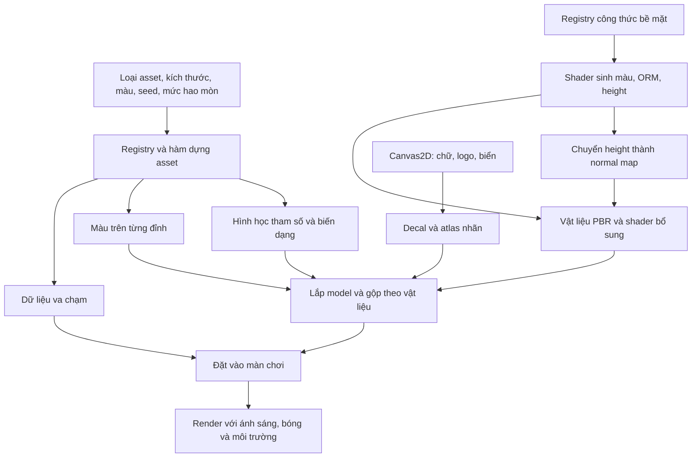

# Saltline: Phân tích kỹ thuật hệ thống tạo asset, hình học và vật liệu bằng mã

[MEOW] **Báo cáo phân tích source đã thu hồi — ngày 11/11/2026.**

Saltline tạo phần lớn tài nguyên đồ họa bằng các công thức nằm trong JavaScript và shader. Model được lắp từ hình học tham số; texture được sinh trên GPU; nhãn được vẽ bằng Canvas; vật liệu ghép các lớp đó với phản ứng ánh sáng và độ ướt. Hệ thống này biến mã nguồn thành nơi lưu trữ cả cấu trúc lẫn diện mạo của tài nguyên.

Điểm quyết định chất lượng là sự phân công giữa các lớp: hình học tạo đường bao và kết cấu; màu đỉnh tạo biến thiên theo vị trí; texture mô tả chi tiết nhỏ; decal cung cấp chữ và biểu tượng; shader vật liệu điều chỉnh cách bề mặt phản sáng. Một container vì thế có thể vừa có gân và vết móp thật, vừa có sơn bong, rỉ, bụi và vệt ẩm mà không cần một file model cùng bộ ảnh texture riêng.

## 1. Phạm vi, nguồn và mức độ xác minh

Đối tượng phân tích là **Saltline gốc**, thu hồi từ [Claude artifact công khai](https://claude.ai/artifact/BGY1SztrAYcJQHSsnHHGmp). Báo cáo không phân tích bản demo Sirocco trong thư mục `demo/`.

Nguồn chính là [bundle đã định dạng để đọc][source], đối chiếu với [manifest phục hồi][manifest]. Bundle vận hành có SHA-256:

```text
8d0057dc4d6dac77e20be2ef1f2b623e19346b5803fde1b3dbabbab508d75d9d
```

Đây là mã đã đóng gói gửi tới browser, có tên biến rút gọn. Định dạng lại giúp đọc cấu trúc nhưng không khôi phục tên module, cây source, lịch sử phát triển hoặc prompt của tác giả. Những tên như `Gg`, `jn`, `M3` trong bài là tên thực sự còn lại trong bundle.

| Loại thông tin | Cách trình bày trong báo cáo |
| --- | --- |
| Đã xác minh từ mã | Nêu hành vi và dẫn tới đoạn source tương ứng |
| Diễn giải kỹ thuật | Giải thích cơ chế nhìn thấy trong source bằng thuật ngữ thông dụng |
| Đánh giá thiết kế | Nêu lợi ích hoặc đánh đổi có thể suy ra, không biến thành số đo |
| Chưa xác minh | Không khẳng định prompt gốc, công cụ tác giả đã sử dụng hay hiệu năng trên mọi thiết bị |

Engine trong bundle là **Three.js r180**, dùng đường render WebGL2. Bài viết dựa vào triển khai đã thu hồi, không giả định API của phiên bản Three.js mới hơn. [Dấu phiên bản][version].

## 2. Bốn khái niệm cần tách riêng

| Thành phần | Dữ liệu thực tế | Quyết định điều gì? |
| --- | --- | --- |
| Geometry — hình học | Đỉnh, tam giác, hướng bề mặt, UV | Hình dáng, đường bao, kết cấu lớn |
| Texture — dữ liệu bề mặt | Mảng điểm ảnh chứa màu hoặc thông số | Chi tiết thay đổi theo từng vị trí trên mặt |
| Material — vật liệu | Texture, màu, độ nhám, tính kim loại, chương trình shader | Bề mặt phản ứng với ánh sáng như thế nào |
| Asset/model — tài nguyên/vật thể | Hình học, vật liệu, cấu trúc bộ phận và dữ liệu đi kèm | Một đối tượng hoàn chỉnh để đặt vào game |

UV là tọa độ dùng để tra texture trên bề mặt. Normal là hướng vuông góc với mặt; nó tham gia tính ánh sáng. Normal map lưu thay đổi nhỏ của hướng này để tạo cảm giác lồi lõm mà không phải thêm toàn bộ chi tiết vào mesh.

**Sinh texture bằng shader không đồng nghĩa sinh model bằng shader.** Trong pipeline đang xét, JavaScript tạo mesh; shader sinh dữ liệu bề mặt và tính diện mạo khi render.

## 3. Kiến trúc tổng thể



Trong các registry liên quan có **36 loại prop**, **29 bộ texture**, **48 mẫu vật liệu** và **22 mẫu decal**. Những con số này biểu thị số định nghĩa trong mã, không phải số mesh, số draw call hoặc số texture đang cấp phát. Một định nghĩa có thể được dùng nhiều lần; một asset có thể gồm nhiều mesh. [Prop][props], [texture][texture-registry], [vật liệu][material-registry], [decal][decal-registry].

Registry prop `Gi` lưu kích thước, vật liệu mặc định và loại bề mặt. Registry `Xg` giữ hàm dựng chi tiết. `Yg().build()` ưu tiên gọi hàm dựng đã đăng ký; chỉ khi không có kết quả phù hợp mới dựng hộp dự phòng. Vì vậy, đọc bảng kích thước rồi kết luận toàn bộ asset chỉ là hộp đơn giản sẽ bỏ qua phần quan trọng nhất. [Cơ chế chọn builder][prop-builder].

## 4. Hình học: từ bộ phận cơ bản đến model hoàn chỉnh

### 4.1. Bộ lắp ráp `jn`

Lớp `jn` cung cấp các thao tác dựng bộ phận và gom chúng theo vật liệu:

| Hàm | Cơ chế | Dạng chi tiết phù hợp |
| --- | --- | --- |
| `box()` | Hộp thường hoặc hộp vát cạnh | Tấm, khung, vỏ máy |
| `cyl()` | Trụ/trụ cụt với số cạnh tùy chọn | Chốt, chi tiết tròn |
| `tube()` | Ống chạy theo đường | Dây, ống dẫn |
| `bar()` | Thanh tròn nối hai điểm | Thanh giằng, tay vịn |
| `beam()` | Thanh hộp nối hai điểm | Dầm, khung chịu lực |
| `decal()` | Mặt phẳng mang vật liệu nhãn | Logo, biển, ký hiệu |
| `push()` / `pop()` | Lưu và khôi phục phép biến đổi | Lắp cụm chi tiết trong hệ tọa độ cục bộ |
| `parts()` | Gộp hình học theo nhóm vật liệu | Giảm số phần riêng trước khi tạo model |

Đối với thanh nối hai điểm, code tính hướng và chiều dài, đặt chi tiết tại trung điểm rồi xoay theo hướng nối. Cách biểu diễn này giúp tác giả mô tả cấu trúc bằng tọa độ thay vì tự tính mọi góc xoay. [Bộ lắp ráp][assembler].

### 4.2. Vát cạnh bằng hình học thật

Hàm `p3()` tự tạo dữ liệu `position`, `normal`, `uv` và chỉ số tam giác cho hộp vát cạnh. Nó giới hạn độ vát theo kích thước khối để tránh phần vát vượt quá bề dày.

Về hình ảnh, các mặt vát có hướng khác mặt chính nên nhận ánh sáng khác nhau. Đây là cơ sở tạo dải sáng ở mép vật thể. Lợi ích này đến từ hình học; texture không thể thay thế hoàn toàn khi nhìn đường bao hoặc góc nghiêng. [Hàm `p3`][bevel].

### 4.3. Kéo đường bao và xoay tiết diện

Các helper của súng bổ sung hai phương pháp:

1. **Extrusion:** `hC()` tạo đường bao 2D, hỗ trợ lỗ; `__()` dùng `ExtrudeGeometry` kéo đường bao thành khối có độ dày và vát cạnh.
2. **Xoay tiết diện:** `Cn()` lấy các điểm mô tả bán kính và vị trí dọc trục, dùng `sin/cos` tạo các vòng đỉnh rồi nối bằng tam giác.

Phương pháp thứ nhất phù hợp với bộ phận có đường bao đặc trưng. Phương pháp thứ hai phù hợp với chi tiết tròn có nhiều bậc. Đây là dựng hình có cấu trúc, không phải chỉ xếp các primitive mặc định. [Helper hình học súng][weapon-geometry].

### 4.4. Màu đỉnh bổ sung thông tin theo vị trí

Hàm `sm()` gán thuộc tính `color` cho geometry, tạo biến thiên sáng tối từ tọa độ và có nhánh xử lý theo hướng normal. Bộ dựng container cũng có hàm màu riêng theo vị trí.

Màu đỉnh được nội suy trên tam giác, phù hợp với các thay đổi tương đối rộng như phần chân bẩn hơn hoặc một bộ phận tối hơn. Chi tiết rất nhỏ vẫn cần texture hoặc mật độ đỉnh cao hơn. [Màu đỉnh trên súng][vertex-color], [bộ dựng container][container-build].

## 5. Trường hợp cụ thể: một container được tạo như thế nào?

### 5.1. Thông số và kết cấu

Trích nguyên cấu hình cơ sở của `container20`:

```js
container20: [6.06, 2.59, 2.44, "paint_red", "metal"]
```

Ba giá trị đầu là kích thước theo các trục của model. Hàm dựng riêng tạo khung, vách, sàn, cửa và các chi tiết đi kèm. Các loại container được đăng ký để gọi builder `M3`. [Kích thước][props], [đăng ký builder][container-registration].

### 5.2. Gân tôn không chỉ là ảnh dán

Hàm `Uc()` tạo tiết diện gân có chu kỳ và độ sâu. Hàm dựng bề mặt nối tiết diện này qua các hàng cao độ để tạo vách. Sau khi áp dụng biến dạng, code tính lại normal của đỉnh.

Như vậy, gân ở vách container là cấu trúc mesh thực. Registry có cả texture `corrugated`, nhưng sự tồn tại của texture đó không có nghĩa mọi gân tôn trong game đều được giả bằng normal map. Phải kiểm tra builder của từng asset. [Tạo tiết diện][profile], [dựng vách container][container-wall].

### 5.3. Vết móp làm dịch chuyển đỉnh

Code tạo danh sách vùng móp, mỗi vùng có vị trí, bán kính, phía vách và độ sâu. Độ lõm giảm dần từ tâm ra mép. Công thức sau được viết lại với tên dễ hiểu, **không phải đoạn source nguyên văn**:

```js
function dentOffset(distanceNormalized, depth) {
  if (distanceNormalized >= 1) return 0;
  return depth * (1 - distanceNormalized ** 2) ** 2;
}
```

Khoảng cách trong triển khai được chuẩn hóa theo bán kính và có điều chỉnh theo chiều cao. Kết quả được dùng khi tính tọa độ vách. Đây là biến dạng hình học; khác với vết xước chỉ thay đổi phản ứng ánh sáng. [Tính vùng móp][container-build].

### 5.4. Biến thể có giới hạn để dùng lại dữ liệu

Builder `M3()` không tạo một mesh hoàn toàn mới cho mọi giá trị đầu vào. Nó chuẩn hóa các thông số trước khi lập khóa bộ nhớ đệm:

- `seed` được chuyển thành số nguyên không âm và lấy phần dư theo `IA = 6` cho biến thể hình học.
- Độ mở cửa được giới hạn trong khoảng 0–1 và làm tròn theo bước 0,1.
- Mức hao mòn được giới hạn trong khoảng 0–1 và làm tròn theo bước 0,5.
- Khóa gồm loại container, biến thể, độ mở cửa và mức hao mòn.
- Màu sơn được gắn vào các phần đã dựng qua vật liệu có `vertexColors`.

Đây là sự cân bằng giữa đa dạng và tái sử dụng. Có thể tạo nhiều diện mạo mà không để số biến thể hình học tăng theo mọi giá trị seed. Không nên gọi đây là “vô hạn model ngẫu nhiên”. [Bộ nhớ đệm container][container-cache].

### 5.5. Hình vẽ và va chạm là hai bộ dữ liệu

Builder trả về cả các phần hình học và danh sách vùng va chạm. Container đóng có thể dùng hộp bao; cấu hình mở có các vùng riêng cho sàn, mái và vách. Các gân nhỏ không bắt buộc trở thành hình va chạm tương ứng.

Khi đặt prop vào map, hệ thống biến đổi dữ liệu va chạm sang tọa độ màn chơi. Cách tách này cho phép mesh nhìn chi tiết trong khi dữ liệu tương tác vẫn đơn giản hơn. [Collider container][container-colliders], [đặt collider vào màn][placement].

## 6. Tạo texture trên GPU

### 6.1. Công thức bề mặt thay cho ảnh đầu vào

Registry `c3` mô tả mỗi bộ texture bằng tên hàm, hệ số kích thước, tỷ lệ lặp, độ nổi và tham số bổ sung. Ví dụ nguyên cấu hình:

```js
paint: { fn: "paint", size: 1, tile: 2.5, bump: 2.5, p: [0.5] }
```

Ở đây `size` là hệ số của độ phân giải tạo texture, không phải chiều dài model. `tile` điều khiển tỷ lệ phủ/lặp; `bump` tham gia chuyển độ cao thành normal; `p` truyền vào uniform tham số của shader. [Registry texture][texture-registry].

Thư viện shader có các hàm tạo noise nhiều tầng `fbm`, phân vùng Voronoi `vor`, vết xước `scr`, mảng bong `chipsF` và mô hình hư hại sơn `paintDmg`. Những hàm này phối hợp các cấu trúc ở nhiều kích thước: hạt nhỏ, vệt vừa và mảng lớn. [Thư viện shader][shader-library].

### 6.2. Một lượt sinh nhiều loại dữ liệu

Factory `Gg()` dựng một mặt phẳng phủ khung hình và camera trực giao, rồi render shader vào render target. Render target trung gian có `count: 3`: ba đầu ra màu cùng được ghi trong một lượt, thường gọi là MRT — Multiple Render Targets.

| Đầu ra | Dữ liệu | Bước sử dụng tiếp theo |
| --- | --- | --- |
| `o0` | Màu và kênh alpha có ý nghĩa theo họ bề mặt | Tạo texture màu; có thể hỗ trợ pha màu sơn |
| `o1` | R: occlusion; G: roughness; B: metalness | Texture ORM dùng chung cho ba thuộc tính |
| `o2` | Height được đóng gói vào hai kênh | Đầu vào cho lượt tạo normal |

Trong đó occlusion mô tả mức che khuất cục bộ, roughness là độ nhám và metalness là tính kim loại. Không nên hiểu kênh occlusion này là toàn bộ bóng đổ của cảnh. [Hàm xuất dữ liệu `emit`][shader-library], [factory GPU][texture-factory].

Sau lượt sinh, code sao chép màu và ORM sang các texture đích, đồng thời tạo normal map từ height. Bộ dữ liệu cuối giữ ba texture: `albedo`, `orm`, `normal`. Height không nằm trong ba texture cuối dùng bởi vật liệu chuẩn ở đường xử lý này.

### 6.3. Kích thước và độ nổi được liên kết

Code tính hệ số normal theo công thức tương đương sau:

```text
kx = bump × 0,001 × textureResolution / tileWidth
ky = bump × 0,001 × textureResolution / tileHeight
```

Hệ số này liên kết độ nổi với độ phân giải và tỷ lệ phủ texture. Vì vậy, thay đổi độ phân giải không chỉ đơn giản làm thay đổi số điểm ảnh mà bỏ qua tỷ lệ gradient. Tuy nhiên, đơn vị thế giới và giá trị `bump` vẫn phải được tác giả chọn nhất quán. [Tạo normal và tỷ lệ texture][texture-factory].

**Giới hạn hình học:** normal map làm thay đổi hướng dùng để tính ánh sáng, không tạo thêm đỉnh hoặc làm đổi đường bao model trong pipeline này. Nó phù hợp với hạt sơn, vết xước và độ sần; các biến dạng lớn cần geometry.

## 7. Vật liệu PBR và mô hình sơn nhiều lớp

### 7.1. Ghép texture vào vật liệu

`Gg().get()` tạo `MeshStandardMaterial` với ánh xạ:

```js
// Minh họa đã đổi tên biến; không phải đoạn source nguyên văn.
const material = new THREE.MeshStandardMaterial({
  map: textureSet.albedo,
  normalMap: textureSet.normal,
  aoMap: textureSet.orm,
  roughnessMap: textureSet.orm,
  metalnessMap: textureSet.orm,
  color: preset.color,
  roughness: preset.rough,
  metalness: preset.metal,
  vertexColors: useVertexColors,
});
```

PBR là mô hình tính ánh sáng dựa trên các thuộc tính như độ nhám và tính kim loại. Việc dùng PBR không tự đảm bảo vật liệu giống thực tế; chất lượng còn phụ thuộc dữ liệu và tham số tác giả chọn. Trong Saltline, vật liệu còn được mở rộng bằng `onBeforeCompile`. [Khởi tạo vật liệu][material-factory].

### 7.2. Sơn bong làm đổi nhiều thuộc tính đồng thời

Shader sơn phân biệt sơn nguyên, sơn lót, vùng rỉ và kim loại mới lộ. Nó thêm bạc màu, bụi, vệt nước rửa và vệt rỉ chảy. Các mặt nạ vùng này tác động đồng thời lên màu, height, roughness, metalness và occlusion.

Ví dụ, công thức đưa roughness vùng rỉ/nền hư hại về phía 0,92, còn vùng kim loại mới lộ về phía 0,35. Đây là giá trị của công thức texture trước các bước điều chỉnh vật liệu tiếp theo, không phải kết quả đo vật lý. [Công thức sơn][paint].

Điểm đáng chú ý là quan hệ giữa các lớp: chỗ sơn bong không chỉ đổi thành màu nâu; nó còn thay đổi cách phản sáng và cấu trúc bề mặt. Vệt rỉ được liên kết với vùng hư hại thay vì xuất hiện hoàn toàn độc lập.

### 7.3. Đổi màu sơn mà vẫn giữ màu rỉ

Tám preset `paint_red`, `paint_blue`, `paint_green`, `paint_yellow`, `paint_orange`, `paint_white`, `paint_grey`, `paint_teal` cùng dùng họ texture `paint` và chế độ `tint: 1`.

Trích công thức pha màu trong shader:

```glsl
diffuseColor.rgb = sampledDiffuseColor.rgb + diffuse * sampledDiffuseColor.a;
```

RGB của texture chứa phần màu đã tính; alpha tham gia điều khiển lượng màu sơn được thêm vào. Kênh alpha ở nhánh này không chỉ mang nghĩa độ trong suốt. Cơ chế đó cho phép đổi màu lớp sơn mà không phải nhuộm đồng loạt mọi lớp rỉ và bẩn. [Preset sơn][material-registry], [shader pha màu][wet-shader].

### 7.4. Độ ướt phụ thuộc vị trí và hướng mặt

Phần shader bổ sung tính mức ướt từ tham số chung, hướng normal, vị trí thế giới và noise. Mặt ngửa chịu ảnh hưởng mạnh; mặt đứng có vệt chảy; mặt dưới giảm ảnh hưởng. Vùng sát đất có thêm dải ẩm và bẩn. Tùy preset, shader còn mô phỏng các điểm nước nhỏ.

Độ ướt làm màu tối hơn, điều chỉnh độ bão hòa, giảm roughness và giảm một phần cường độ normal trên mặt ngửa. Đây là mô hình hình ảnh theo công thức, không phải mô phỏng dòng chảy chất lỏng. [Màu và độ ướt][wet-shader], [roughness và normal][roughness-shader].

## 8. Decal, chữ và atlas

Các chi tiết cần nội dung rõ ràng như logo, nhãn thông số, chữ số, biển cấm và cảnh báo được vẽ bằng Canvas2D. Canvas được chuyển thành texture; vật liệu decal bật trong suốt, tắt ghi depth và sử dụng `polygonOffset` để giảm xung đột chiều sâu với mặt đỡ.

Một số vết bẩn và dấu tác động cũng có mẫu decal riêng. Không phải mọi decal đều là chữ, và không phải mọi vết bẩn đều đến từ decal: shader vật liệu cũng tạo bẩn trực tiếp. [Tạo vật liệu decal][decal-factory].

Nhãn trong màn có bước ghép vào atlas — một texture lớn chứa nhiều nhãn nhỏ. Lợi ích thiết kế là tạo điều kiện chia sẻ texture và vật liệu. Atlas không tự động làm mọi nhãn chỉ còn một draw call; kết quả còn phụ thuộc cách gộp mesh và trạng thái render. [Atlas nhãn][atlas].

## 9. Asset có chuyển động và bề mặt đặc biệt

Hệ thống tạo bằng mã không chỉ áp dụng cho vật thể tĩnh. Builder của kẻ địch tạo bone, dữ liệu `skinIndex`, `skinWeight` và skeleton. Trong hàm gắn bộ phận được kiểm tra, mỗi đỉnh được gán trọng số 1 cho bone của bộ phận đó: phù hợp với các khối máy móc chuyển động cứng theo khớp. Đây không phải bằng chứng về một quy trình skin mềm thủ công trong Blender. [Dựng rig][rig].

Mặt đất và nước có pipeline riêng cho vũng nước, vết dầu, khe/nứt, vạch sơn và phản chiếu. Vì vậy, không nên quy mọi bề mặt trong game về duy nhất factory vật liệu chuẩn. Phản chiếu phẳng là dữ liệu render từ cảnh, khác với texture bề mặt sinh bằng noise. [Shader mặt đất][ground], [phản chiếu phẳng][reflection].

## 10. Tối ưu tài nguyên và chi phí thực tế

### 10.1. Những biện pháp có trong code

| Biện pháp | Cách triển khai | Ý nghĩa |
| --- | --- | --- |
| Tạo theo nhu cầu | Chỉ sinh bộ texture khi được yêu cầu; có `prewarm()` | Cho phép kiểm soát thời điểm tạo |
| Bộ nhớ đệm | Giữ texture theo bộ, vật liệu theo khóa lựa chọn | Tránh tạo lại cùng dữ liệu |
| Biến thể hữu hạn | Chuẩn hóa tham số container trước khi lập khóa | Hạn chế số hình học khác nhau |
| Gộp mesh | Gom theo vật liệu, cờ bóng và layer | Có thể giảm số lệnh vẽ |
| Bảo toàn phần động | Bỏ qua `noMerge`, skinned mesh và một số trường hợp khác | Không làm mất cấu trúc cần hoạt ảnh |
| Dọn dữ liệu tạm | Giải phóng render target/shader sinh sau khoảng không hoạt động | Giảm phần tài nguyên trung gian còn giữ |

Factory dọn tài nguyên trung gian sau hơn 4 giây kể từ lần sinh gần nhất khi điều kiện cập nhật thỏa mãn. Đây không phải việc xóa các texture cuối mà vật liệu vẫn đang dùng. [Vòng đời factory][factory-lifecycle], [gộp mesh][merge].

### 10.2. Bundle nhỏ không đồng nghĩa dùng ít bộ nhớ GPU

Code có thể lưu công thức ngắn, nhưng kết quả vẫn cần texture và buffer trên GPU. Theo chính mô hình ước lượng của factory, một texture RGBA có mipmap được tính gần đúng:

```text
bytes ≈ width × height × 4 × 1,34
```

Ba texture 1024 × 1024 theo mô hình này chiếm khoảng **16,1 MiB**. Đây chỉ là phép tính cho một bộ ba texture, không phải phép đo VRAM của game; chưa gồm render target tạm, geometry, shadow map, phản chiếu, hậu kỳ hoặc chi phí driver. [Cấp phát và thống kê texture][texture-factory].

### 10.3. Các đánh đổi cần nhận diện

- Chi phí tải tài nguyên có thể được chuyển thành chi phí tính toán khi khởi tạo.
- Gộp mesh giảm số đối tượng/lệnh vẽ nhưng có thể làm vùng loại bỏ ngoài camera kém chi tiết hơn; cần đo trên cách bố trí thực tế.
- Một bộ texture dùng lại nhiều lần có thể lộ hoa văn lặp; biến thể hình học, màu đỉnh, decal và biến thiên theo tọa độ thế giới giúp giảm cảm giác lặp.
- Dựng asset bằng code làm việc chỉnh hình phụ thuộc tham số và logic; thao tác mỹ thuật không trực tiếp như kéo đỉnh trong công cụ dựng hình.
- Không thể kết luận hiệu năng tốt trên mọi GPU chỉ từ các biện pháp tối ưu trong source.

Các điểm trên là đánh giá kỹ thuật về cấu trúc đã quan sát, không phải kết quả benchmark mới.

## 11. Nguyên tắc thiết kế có thể rút ra

| Quy mô chi tiết | Lớp xử lý phù hợp trong hệ thống này | Ví dụ |
| --- | --- | --- |
| Đường bao và kết cấu lớn | Geometry | Khung, cửa, nòng, gân lớn |
| Biến dạng có thể thấy ở góc nghiêng | Dịch chuyển đỉnh | Móp vách container |
| Thay đổi rộng theo vị trí | Màu đỉnh và shader theo tọa độ | Chân bẩn, vùng tối, dải ẩm |
| Chi tiết nhỏ của bề mặt | Texture màu, ORM, normal | Hạt sơn, xước, sần |
| Nội dung có nghĩa cụ thể | Decal/Canvas | Logo, số, biển cảnh báo |
| Trạng thái môi trường | Uniform và shader vật liệu | Độ ướt, thay đổi độ nhám |

Giá trị của kiến trúc này nằm ở việc chọn đúng lớp biểu diễn. Chi tiết làm đổi hình dáng được đưa vào mesh; chi tiết nhỏ được đưa vào texture; thông tin nhận diện được đưa vào decal. Một model tốt không cần đẩy mọi chi tiết vào cùng một phương pháp.

Ngoài ra, vật liệu được mô tả như một hệ thống lớp có liên hệ: sơn bong làm lộ lớp bên dưới, vùng lộ thay đổi phản sáng, rỉ có vệt chảy, độ ướt phụ thuộc hướng mặt. Sự nhất quán này giải thích cách code hướng tới hình ảnh thuyết phục hơn việc chỉ tăng số polygon hoặc tăng độ phân giải texture.

## 12. Giới hạn và kết luận

Trong gói đã phục hồi, phần asset được phân tích được tạo từ mã; không có bộ model `.glb/.fbx` và ảnh texture ngoài tương ứng được thu hồi. Điều đó không chứng minh tác giả chưa từng dùng công cụ mỹ thuật, ảnh tham khảo hay bước trung gian ở quá trình sáng tác. Font còn là tài nguyên ngoài, nên cũng không gọi toàn bộ game là không có phụ thuộc mạng.

Báo cáo này là phân tích tĩnh có dẫn chiếu. Không có benchmark mới, phép đo chất lượng thị giác hay thử nghiệm mọi biến thể asset được thực hiện cho riêng tài liệu này. Các kết quả kiểm tra gameplay đã có nằm trong [báo cáo kiểm chứng trước đó][verification] và không thay thế kiểm chứng chuyên biệt về vật liệu.

**Saltline triển khai một pipeline nội dung bằng mã có nhiều lớp:** bộ dựng hình học tham số, hệ thống biến thể có bộ nhớ đệm, bộ sinh texture GPU, vật liệu PBR được mở rộng, Canvas decal và bước gộp tài nguyên. Nó vượt xa cách ghép hộp rồi tô màu nhờ kết hợp cấu trúc hình học thật với mô hình hao mòn bề mặt có quan hệ. Đây là kết luận được hỗ trợ bởi source; prompt gốc và trình tự sáng tác của tác giả vẫn chưa biết.

## Phụ lục: bản đồ source để tiếp tục nghiên cứu

Các liên kết dưới đây trỏ tới file local trong gói phục hồi. Số dòng thuộc bản `game.pretty.js` hiện tại; nếu định dạng lại file, số dòng có thể thay đổi.

| Chủ đề | Điểm vào |
| --- | --- |
| Nguồn và hash | [Manifest phục hồi][manifest] |
| Bộ dựng prop và phương án dự phòng | [`Yg`][prop-builder] |
| Hộp vát cạnh | [`p3`][bevel] |
| Tiết diện gân | [`Uc`][profile] |
| Bộ lắp ráp | [`jn`][assembler] |
| Container và biến thể | [`zA`][container-build], [`M3`][container-cache] |
| Hình học súng | [Extrusion và xoay tiết diện][weapon-geometry] |
| Công thức bề mặt | [Noise, xước, bong sơn][shader-library] |
| Mô hình sơn | [`Tn.paint` và phần dùng chung][paint] |
| Texture và vật liệu | [`c3`][texture-registry], [`l1`][material-registry], [`Gg`][texture-factory] |
| Shader mở rộng | [Màu và độ ướt][wet-shader], [độ nhám và normal][roughness-shader] |
| Decal | [Canvas và vật liệu][decal-factory], [atlas nhãn][atlas] |
| Rig | [Bone và skinning][rig] |
| Tối ưu | [Gộp mesh][merge], [vòng đời factory][factory-lifecycle] |
| Tài liệu liên quan | [Danh mục tài nguyên][assets-report], [kỹ thuật và quy trình gốc][workflow-report] |

[source]: /Users/meow/rea/saltline-reverse/evidence/game.pretty.js
[manifest]: /Users/meow/rea/saltline-reverse/evidence/recovery-manifest.json
[version]: /Users/meow/rea/saltline-reverse/evidence/game.pretty.js:431
[props]: /Users/meow/rea/saltline-reverse/evidence/game.pretty.js:40627
[prop-builder]: /Users/meow/rea/saltline-reverse/evidence/game.pretty.js:40668
[bevel]: /Users/meow/rea/saltline-reverse/evidence/game.pretty.js:40760
[profile]: /Users/meow/rea/saltline-reverse/evidence/game.pretty.js:40968
[assembler]: /Users/meow/rea/saltline-reverse/evidence/game.pretty.js:41060
[container-build]: /Users/meow/rea/saltline-reverse/evidence/game.pretty.js:41271
[container-wall]: /Users/meow/rea/saltline-reverse/evidence/game.pretty.js:41450
[container-cache]: /Users/meow/rea/saltline-reverse/evidence/game.pretty.js:41874
[container-colliders]: /Users/meow/rea/saltline-reverse/evidence/game.pretty.js:41860
[container-registration]: /Users/meow/rea/saltline-reverse/evidence/game.pretty.js:44050
[placement]: /Users/meow/rea/saltline-reverse/evidence/game.pretty.js:48432
[weapon-geometry]: /Users/meow/rea/saltline-reverse/evidence/game.pretty.js:64249
[vertex-color]: /Users/meow/rea/saltline-reverse/evidence/game.pretty.js:64207
[shader-library]: /Users/meow/rea/saltline-reverse/evidence/game.pretty.js:37630
[paint]: /Users/meow/rea/saltline-reverse/evidence/game.pretty.js:37815
[texture-registry]: /Users/meow/rea/saltline-reverse/evidence/game.pretty.js:39346
[material-registry]: /Users/meow/rea/saltline-reverse/evidence/game.pretty.js:39425
[texture-factory]: /Users/meow/rea/saltline-reverse/evidence/game.pretty.js:39765
[material-factory]: /Users/meow/rea/saltline-reverse/evidence/game.pretty.js:39920
[wet-shader]: /Users/meow/rea/saltline-reverse/evidence/game.pretty.js:39645
[roughness-shader]: /Users/meow/rea/saltline-reverse/evidence/game.pretty.js:39703
[decal-factory]: /Users/meow/rea/saltline-reverse/evidence/game.pretty.js:38337
[decal-registry]: /Users/meow/rea/saltline-reverse/evidence/game.pretty.js:38432
[atlas]: /Users/meow/rea/saltline-reverse/evidence/game.pretty.js:48601
[rig]: /Users/meow/rea/saltline-reverse/evidence/game.pretty.js:67656
[ground]: /Users/meow/rea/saltline-reverse/evidence/game.pretty.js:54599
[reflection]: /Users/meow/rea/saltline-reverse/evidence/game.pretty.js:54828
[factory-lifecycle]: /Users/meow/rea/saltline-reverse/evidence/game.pretty.js:40007
[merge]: /Users/meow/rea/saltline-reverse/evidence/game.pretty.js:35495
[verification]: /Users/meow/rea/saltline-reverse/evidence/verification-report.json
[assets-report]: /Users/meow/rea/saltline-reverse/ASSETS.md
[workflow-report]: /Users/meow/rea/saltline-reverse/ORIGINAL-WORKFLOW.md
